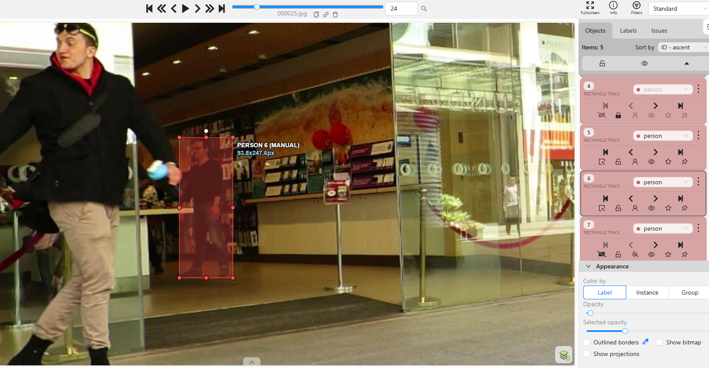
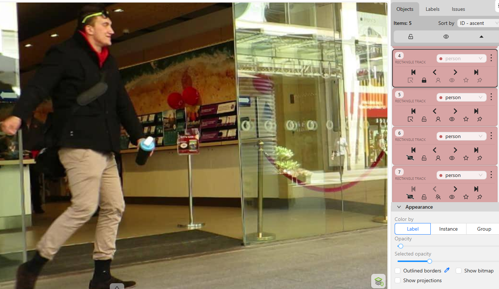
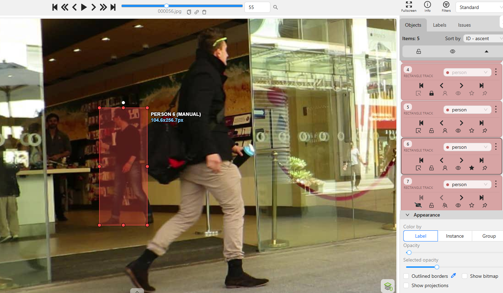

# Báo cáo cá nhân — 2A202603057_NguyenTuanDiep

Đoạn video: MOT17-09, 150 frame (frame 1–150), nguồn MOTChallenge, giấy phép CC BY-NC-SA 3.0.

## 0. Thông tin học viên

- Họ tên: Nguyễn Tuấn Điệp
- MSSV: 2A202603057
- Mã đề (A/B/C): A
- Email: diepnguyentuan99@gmail.com
- Link repository: https://github.com/diepnguyentuan/K5-L2-DAY05-NguyenTuanDiep-2A202603057-MOTTracking
- Giờ bắt đầu: 16:00 (13/11/2026)
- Giờ kết thúc: 09:00 (14/11/2026)

## 1. Xem trước đoạn video (CP0)

Ghi **trước khi vẽ**, mỗi người một dòng.

| Mã | Frame xuất hiện | Frame cuối thấy được | Rẽ / dừng / đổi tốc độ ở frame | Bị che ở frame | Ghi chú |
|---|---:|---:|---|---|---|
| P1 | 0 | 149 | Đi bộ từ trong cửa hàng ra ngoài, hơi rẽ hướng ra cửa khoảng 50–60 | 30–54 (khuất hẳn 41–49) | Nam áo đen, quần jean trong cửa hàng Vodafone |
| P2 | 61 | 149 | Đi từ sau quầy/cửa kính bên trái ra phía trước | 61–73 | Nữ áo sát nách trắng-cam, quần đen |
| P3 | 0 | 149 | Đi thẳng tương đối đều về phía camera | Không | Bà cụ áo khoác xanh rêu, đeo túi đen |
| P4 | 0 (bắt đầu vào rõ ~40) | 149 | Đi thẳng bên cạnh P3 từ mép phải vào | Không | Ông cụ áo xanh dương, đội mũ trắng |
| P5 | 0 | 147 | Đứng và di chuyển chậm, sau đó đi ngang sang phải | 106–110, khuất hẳn 111–134, hiện lại 135–147, khuất sau P4 từ 148 | Em bé áo sáng màu phía trước cửa hàng xanh |

## 2. Keyframe và thời gian (CP1, CP4)

Số keyframe lấy từ kết quả `src/check_submission.py`.

| Mã | Số keyframe | Keyframe ở frame | Số frame có mặt | Keyframe / 100 frame | Thời gian (phút) | Chỗ khó |
|---|---:|---|---:|---:|---:|---|
| P1 (CVAT Track 3) | 17 | 0, 10, 20, 30, 40, 50, 55, 60, 70, 80, 90, 100, 110, 120, 130, 140, 149 | 141 | 12.1 | ~24 | Đoạn bị người áo khoác đen đi ngang che (30–54) |
| P2 (CVAT Track 4) | 11 | 61, 71, 74, 80, 90, 100, 110, 120, 130, 140, 149 | 89 | 12.4 | ~14 | Bước ra từ sau bàn và trụ kính (61–73) |
| P3 (CVAT Track 0) | 18 | 0, 10, 20, 30, 40, 50, 60, 70, 80, 90, 100, 110, 120, 130, 140, 142, 148, 149 | 150 | 12.0 | ~20 | Đi lại gần camera nên kích thước box lớn dần, cuối đoạn thêm keyframe ở 142, 148 |
| P4 (CVAT Track 1) | 13 | 40, 50, 60, 70, 80, 90, 100, 110, 120, 130, 140, 143, 149 | 110 | 11.8 | ~15 | Đoạn đầu mới bước vào từ mép phải ảnh, thêm keyframe 143 chỉnh sát phần mũ |
| P5 (CVAT Track 2) | 13 | 0, 10, 20, 30, 40, 50, 60, 80, 90, 100, 106, 135, 140 | 123 | 10.6 | ~21 | Bị che bởi P3 và P4 ở cuối đoạn (106–149), bật `outside` từ frame 147 |
| **Tổng** | **72** | — | **613** | **11.7** | **~94** | |

*(Thời gian từng người được ước lượng lại dựa trên mốc tạo task CVAT lúc `16:30`, chụp ảnh minh chứng lúc `18:24–18:29`, xuất bản đầu lúc `18:34` ngày 13/11 và thời gian mở lại job rà soát, chỉnh sửa xuất lại lúc `08:52–08:55` ngày 14/11.)*

Keyframe / 100 frame của cả bài = tổng keyframe ÷ tổng số frame có mặt × 100 = 72 ÷ 613 × 100 = **11.7**

Bạn đặt keyframe nhiều nhất ở người nào? Vì sao (người đó rẽ, dừng, lại gần camera hay bị che)?

- Theo số lượng keyframe: **P3** nhiều nhất (**18 keyframe**) vì có mặt suốt cả 150 frame và di chuyển lại gần camera làm kích thước box tăng nhanh ở cuối đoạn nên sau khi tự review tôi đặt thêm keyframe ở frame `142` và `148` để bám gọn tay và thân người (kế tiếp là **P1** với **17 keyframe** do xử lý đoạn bị che 30–54).
- Theo mật độ (keyframe / 100 frame): **P2** cao nhất (**12.4 keyframe / 100 frame**) do xuất hiện muộn từ frame 61 và cần chỉnh thêm keyframe ở đoạn mới bước qua mép bàn (71, 74).

## 3. Đoạn bị che (CP2)

Người bị che: `P1` (CVAT Track 3 / MOT Track 3)

| Mốc | Frame |
|---|---:|
| Bắt đầu bị che một phần (bật `occluded`) | 30 |
| Mất hẳn (bật `outside`) | 41 |
| Hiện lại (tắt `outside`) | 50 |
| Thấy rõ trở lại (tắt `occluded`) | 55 |

- Thời gian khuất hẳn: `9` frame (từ frame 41 đến frame 49) = `0.3` giây (ở 30 fps).
- Quyết định: **giữ cùng ID**.
- Lý do (trả lời 3 câu: khuất bao lâu so với 60 frame, ngoại hình có khớp, chỗ hiện lại có đúng hướng và tốc độ):
  1. Thời gian khuất hẳn chỉ 9 frame (~0.3 giây), nhỏ hơn nhiều so với ngưỡng 60 frame (2 giây) của lớp.
  2. Ngoại hình khi hiện lại khớp hoàn toàn (nam mặc áo dài tay đen, quần jean xanh).
  3. Vị trí hiện lại tiếp nối đúng hướng đi và tốc độ bước từ trong cửa hàng Vodafone ra phía cửa.

*(Ghi chú thêm: P5 cũng có đoạn khuất hẳn sau P3 từ frame 111–134, tổng 24 frame = 0.8 giây ≤ 60 frame, nên giữ cùng ID.)*

Ảnh chụp màn hình (nguồn: MOT17, MOTChallenge (Milan et al., 2016)):





## 4. Tự review ID (CP3)

Lượt 1 theo người (đi ngược từ frame 149 về 0 trên CVAT), lượt 2 theo cảnh (nhảy 10 frame). Ít nhất 3 dòng; không có lỗi thì ghi một dòng "đã kiểm hai lượt, không lỗi".

Loại lỗi dùng đúng một trong 7 mã: `id_switch`, `fragmentation`, `lost`, `merge`, `false_track`, `drift`, `flag`.

| Frame | Mã người | Loại lỗi | Mô tả một câu | Phát hiện ở lượt | Đã sửa? |
|---:|---|---|---|---|---|
| 40 | P1 | `flag` | Tại keyframe 40 ngay trước khi bật `outside` (frame 41), P1 đã bị người áo khoác đen che nhưng cờ `occluded` bị tắt về `0`. | Lượt 1 (theo người) | Đã sửa (bật lại `occluded = 1` tại frame 40) |
| 143 | P4 | `drift` | Giữa keyframe 140 và 149 khi P4 tiến nhanh lại gần camera, mép trên box nội suy hơi hạ thấp sát phần chóp mũ trắng. | Lượt 1 (theo người) | Đã sửa (thêm keyframe tại 143 nâng mép trên box lên ôm trọn mũ) |
| 142 | P3 | `drift` | Giữa keyframe 140 và 149 khi P3 bước gần camera và vung tay phải, bàn tay phải hơi ló ra ngoài mép trái box nội suy. | Lượt 2 (theo cảnh) | Đã sửa (thêm keyframe tại 142 kéo rộng mép trái từ `979.2` sang `968.7` px và chỉnh thêm ở 148) |
| 147 | P5 | `flag` | Khi P4 bước cắt ngang qua tiền cảnh, tại frame 147 P5 thực tế đã khuất hẳn sau quần P4 nhưng trước đó đến frame 148 mới bật cờ `outside`. | Lượt 2 (theo cảnh) | Đã sửa (bật `outside = 1` sớm hơn từ frame 147) |

Tổng hợp số lỗi theo loại:

| `id_switch` | `fragmentation` | `lost` | `merge` | `false_track` | `drift` | `flag` |
|---:|---:|---:|---:|---:|---:|---:|
| 0 | 0 | 0 | 0 | 0 | 2 | 2 |

Lỗi nào chỉ lượt 2 (theo cảnh) mới thấy, lượt 1 (theo người) không thấy? Vì sao?

- Lỗi chỉ rõ khi kiểm tra lượt 2 là **P5 bị P4 che khuất hoàn toàn ở frame 147 (`flag`)** và phần **tay phải P3 vung ra sát rìa box khi đi song song với P4 quanh frame 142 (`drift`)**.
- Lý do: ở lượt 1 đi ngược theo từng người, tôi chỉ tập trung vào một box đơn lẻ nên với P5 (box nhỏ và gần như đứng yên ở nền sau) khó thấy rõ thời điểm mép quần của P4 ở tiền cảnh lướt qua che kín hoàn toàn; khi chuyển sang lượt 2 nhảy từng màn nhìn cả 5 box cùng lúc mới đối chiếu được ranh giới che khuất giữa P4–P5 và khoảng mở tay của P3 ở rìa khung.

## 5. File xuất và kết quả tự kiểm (CP4)

| Kiểm tra | Kết quả |
|---|---|
| Tên file MOT 1.1 | `src/exports/NguyenTuanDiep_mot.zip` |
| Tên file CVAT for video 1.1 | `src/exports/NguyenTuanDiep_cvat_video.zip` |
| Số track ID khác nhau trong `gt/gt.txt` (phải là 5) | `5` |
| Frame `outside` không có dòng trong `gt.txt` (đúng / sai) | `đúng` |
| Job đã completed trên CVAT máy cá nhân | Đã completed |

Dán phần tóm tắt in ra từ `src/check_submission.py`:

```text
Số frame in theo CVAT (bắt đầu từ 0). Trong gt.txt, frame_id = frame CVAT + 1.

=== File MOT 1.1: NguyenTuanDiep_mot.zip ===
  Số track ID: 5   |   Tổng số box: 613
  [OK]        Đúng 5 track ID.

  Track | Frame có mặt | Số frame | Đoạn vắng (outside)
      1 |   0–149      |      150 | -
      2 |   0–146      |      123 | 111–134
      3 |   0–149      |      141 | 41–49
      4 |  40–149      |      110 | -
      5 |  61–149      |       89 | -


=== File CVAT for video 1.1: NguyenTuanDiep_cvat_video.zip ===

  Track | Nhãn   | Frame thấy | Keyframe | KF/100 frame | Frame occluded | Lần bật outside
      0 | person |        150 |       18 |         12.0 |              1 |               0
              Track 0: keyframe ở frame [0, 10, 20, 30, 40, 50, 60, 70, 80, 90, 100, 110, 120, 130, 140, 142, 148, 149]
      1 | person |        110 |       13 |         11.8 |              0 |               0
              Track 1: keyframe ở frame [40, 50, 60, 70, 80, 90, 100, 110, 120, 130, 140, 143, 149]
      2 | person |        123 |       13 |         10.6 |             17 |               2
              Track 2: keyframe ở frame [0, 10, 20, 30, 40, 50, 60, 80, 90, 100, 106, 135, 140]
      3 | person |        141 |       17 |         12.1 |             16 |               1
              Track 3: keyframe ở frame [0, 10, 20, 30, 40, 50, 55, 60, 70, 80, 90, 100, 110, 120, 130, 140, 149]
      4 | person |         89 |       11 |         12.4 |             13 |               0
              Track 4: keyframe ở frame [61, 71, 74, 80, 90, 100, 110, 120, 130, 140, 149]

  Tổng: 72 keyframe / 613 frame có mặt = 11.7 keyframe / 100 frame
  [OK]        Đọc được 5 track từ annotations.xml.

=== Tóm tắt ===
  Lỗi: 0   |   Cảnh báo: 0
  Đạt. Dán phần tóm tắt này vào báo cáo mục 5.
```

## 6. Ba câu kết

1. Nếu được gán lại, bạn sẽ đặt keyframe khác ở đâu? Vì sao?

   Từ kinh nghiệm sau hai lượt rà soát và chỉnh sửa, tôi sẽ điều chỉnh ngay từ đầu ở ba chỗ:
   - **Đặt keyframe dày hơn ở đoạn cuối (frame 130–149) cho P3 và P4:** khi hai người đi nhanh lại gần camera, chiều cao box tăng nhanh (P3 từ `697` lên `834` px, P4 từ `801` lên `940` px) kèm chuyển động đánh tay nên bước nhảy đều 10 frame bị trễ nhẹ, về sau tôi phải chèn thêm keyframe ở `142, 148` (P3) và `143` (P4) mới bám sát tay và mũ.
   - **Kiểm tra kỹ cờ ngay tại các frame sát mốc che khuất:** ban đầu ở frame `40` của P1 bị tắt nhầm `occluded` trước khi bật `outside` ở `41`, còn P5 đến `148` mới bật `outside` dù `147` đã khuất sau P4; nếu làm lại sẽ soi từng frame ở biên che để tránh phải quay lại sửa.
   - **Phân bổ lại mật độ cho P5 và P4:** đoạn `0–100` P5 đứng gần như yên nên có thể đặt keyframe thưa hơn thay vì đều mỗi 10 frame, còn P4 có thể gán sớm hơn trước frame `40` từ lúc nửa người đã vào rõ ở mép phải ảnh (khoảng frame 20).

2. Có chỗ nào bạn không chắc "cùng ID hay ID mới"? Bạn đã quyết định và ghi chú thế nào?

   Chỗ khiến tôi phải kiểm tra kỹ nhất là **P5 (em bé áo sáng màu trước cửa hàng Woolworths)** khi bị P3 đi ngang che khuất hoàn toàn trong **24 frame** (từ frame `111` đến `134`, tức khoảng `0.8` giây ở 30 fps), rồi chỉ ló ra ngắn ở khe hẹp giữa túi xách của P3 và thân P4 trong đoạn `135–146` trước khi bị P4 che hẳn từ frame `147`. Lúc xem nhanh dễ nhầm P5 với người đứng phía sau trong sảnh hoặc tưởng đã khuất hẳn. Tôi áp dụng quy tắc 3 câu của lớp: thời gian khuất `24 ≤ 60` frame, ngoại hình khi ló lại khớp hoàn toàn (váy sáng màu và giày đỏ), vị trí vẫn giữ gần như đứng yên tại `x ≈ 1315–1365`, nên quyết định **giữ cùng ID** (CVAT Track 2 / MOT Track 2) và ghi chú bổ sung ở mục 3 (cùng với ca chính của P1 khuất 9 frame = 0.3 giây).

3. Một lỗi ID trong job của bạn (nếu không còn sót, chọn lỗi đã sửa) có thể làm xe tự lái dự đoán sai chuyển động của người đó như thế nào? Lỗi đó ảnh hưởng MOTA hay IDF1 nhiều hơn?

   Sau khi tự review và sửa lại các lỗi `flag` và `drift` ở mục 4, file nộp hiện tại không còn `id_switch` hay `fragmentation`. Tuy nhiên, xét điểm có nguy cơ lỗi ID cao nhất trong bài là **đoạn P1 bị che qua cửa (frame 41–49)** hoặc **P5 bị P3 che (frame 111–134)**: nếu lúc gán để xảy ra `id_switch` (ID của P1 nhảy sang người áo khoác đen đi ngang, hoặc ID của P5 nhảy sang người phía sau) thì chỉ trong 1 frame, tâm box sẽ dịch chuyển đột ngột một quãng lớn, làm bộ ước lượng vận tốc của xe tự lái tính ra hướng di chuyển và tốc độ phi lý (ví dụ tưởng người trong cửa hàng bất ngờ lao ngang ra lề đường) và đưa ra dự đoán quỹ đạo va chạm sai. Còn nếu đứt thành ID mới (`fragmentation`), hệ thống mất lịch sử quỹ đạo cũ để suy ra hướng đi tiếp theo.

   Lỗi ID (`id_switch` / `fragmentation`) ảnh hưởng **IDF1 nhiều hơn MOTA**:
   - **MOTA** (`1 - (FN + FP + IDSW) / GT`) chỉ phạt theo từng lần đổi ID: trong tổng số `613` box của bài, `1` lần `id_switch` chỉ làm MOTA giảm khoảng `1 / 613 ≈ 0.16%`.
   - **IDF1** (`2·IDTP / (2·IDTP + IDFP + IDFN)`) ghép cả track dự đoán với cả track ground truth: nếu một người bị tách làm hai ID ở giữa đoạn (chẳng hạn P1 đứt ở frame `50` hoặc P5 đứt ở frame `135`), gần một nửa số frame còn lại không được tính vào ID chính, làm điểm **IDF1** giảm rất mạnh.

## 7. Tài liệu tham khảo và công cụ AI đã dùng

- Dữ liệu MOT17-09: MOTChallenge (Milan et al., 2016), giấy phép CC BY-NC-SA 3.0.
- Tài liệu hướng dẫn của lớp: `docs/GUIDELINE.md`, `docs/CVAT_CHEATSHEET.md`, `docs/MOT_FORMAT.md`, `CHECKPOINTS.md`.
- Công cụ hỗ trợ: script `src/setup_local_lab.py`, `src/check_submission.py`; công cụ AI hỗ trợ dạng chat dùng để kiểm tra cú pháp file xuất, đối chiếu thông số keyframe/flag trên từng khung hình và rà soát trình bày báo cáo.
